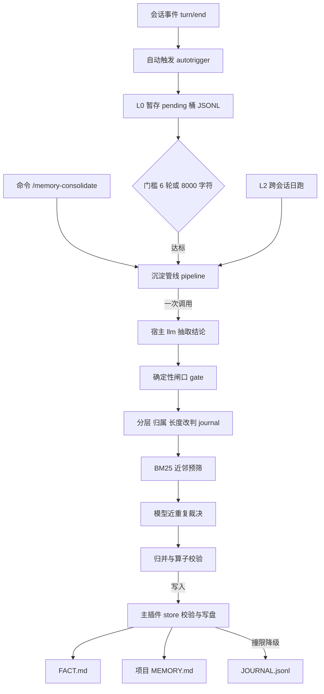

# 记忆自动沉淀（persona-memory-consolidate）

[](LICENSE)

主插件 [dsh-persona-memory](https://github.com/hu568/dsh-plugin-persona-memory) 的写侧插件：回合结束只写 L0 暂存，攒够 6 轮或 8000 字符才花一次模型调用抽结论，撞限只降级 JOURNAL，绝不压缩。

| 状态 | 信息 |
| --- | --- |
| 最新版本 | [0.7.1](https://github.com/hu568/dsh-plugin-persona-memory-consolidate/releases) |
| 平台 | DSH 宿主组合（宿主平面插件；桌面端与 Web 会话通用） |
| 技术栈 | 纯 ESM JavaScript · 无构建步骤（`lib/*.js` 直接加载）· Cordis 插件 · DSH 宿主 API（`commands`、`llm`、`personaMemory.settings`） |
| 核心引擎 | 两段式沉淀：L0 纯本地暂存 → 门槛达标后一次 LLM 抽取 → 确定性闸口与改判 → BM25 近邻预筛 + 模型近重复裁决 → 主插件 `store` 写入 |
| 运行依赖 | 本地文件 `$DSH_HOME/memory/consolidate/`；宿主 `llm` 服务（模型沿用会话 route 或宿主默认）；主插件 `@dsh-external/dsh-persona-memory >=0.7.0 <0.14.0`；`schemastery` |

最近一版 0.7.1 把近重复裁决的近邻从「整个池 top-2」改为「同作用域 top-2 + 跨作用域 top-2」，并补上别名、partial、抽象层三类判定口径；逐版本记录见 [docs/CHANGELOG.md](docs/CHANGELOG.md)。

---

## ✨ 功能总览

### 自动沉淀：把对话变成结论

- **回合结束只写 L0**：每轮压成一行 JSONL 追加进 `pending/<workspaceId>/<sessionId>.jsonl`，纯本地写、不调用模型，不拖慢用户请求；`turn/end` 自动触发，`agent/status` 补漏，`idleScanMinutes` 兜底扫描。
- **攒够门槛才花一次 LLM**：未消费回合 ≥ `minTurns`（6）或字符 ≥ `minChars`（8000），先到先算；一次最多抽 8 条结论，单次输入上限 8000 字符。

### 写入质量门：先丢噪音，再判重复

- **确定性闸口**：空壳/占位、过程叙述、短于 8 字、同批重复、状态断言缺时点、助手服务边界，落盘前丢弃并按原因计数；`gateEnabled: false` 可一键整批放行。
- **三层改判不丢内容**：`kind=detail` 或 `importance≤2`、归属不到工作区、正文超过 160 字的 global/project 候选，一律改判 `scope=journal`——内容照写，只离开每轮静态注入。
- **近重复两道拦截**：跨池 BM25 只拦 exact / ≥0.95；换说法的近义改写交给 `dedupeModel` 的小调用裁决（同作用域 top-2 + 跨作用域 top-2），判重改判 NOOP，异常一律放行。
- **重要性写入**：`importance` 1–5 映射成 20/35/50/70/90 写进主插件侧车索引，只参与排序与淘汰评分，不改正文格式。

### 运行、观测与写入边界

- **三档运行**：`off` 完全静默、`observe` 真跑管线但只写 `would-write/` 影子文件、`auto` 正式写入；`/memory-consolidate dry` 做一次性演练。
- **打码、日志与回滚**：密钥、手机号、身份证、卡号写前按正则打码；`runs.jsonl` 只留结构化摘要，正文不进日志；正式运行写前快照到 `backups/<runId>/`（保留 10 份），可按 runId 或最近一份回滚。
- **只降级，不压缩**：主插件回「超限」时不做任何合并、截断或改写，只把该条降级成 JOURNAL 追加；`demoted:'drop'` 记 FAILED，绝不假装写成。
- **唯一写入通道是主插件**：本插件不自己 `fs` 写 FACT / MEMORY / JOURNAL；模板、校验、备份、原子写、锁全在主插件 `store`。
- **不在请求路径上工作**：不订阅 `agent/pre-step`，单飞 + 全局并发 1，日预算 60 次（L1 50 / L2 10）。

### 跨会话整理（L2）

- **日跑升格**：每天一次或新增素材 ≥20 条触发；同一结论真实出现 ≥2 次才升格为稳定事实，项目专属结论不再双写 global。数据源三档里 `journal` 默认零依赖，`service` 走宿主精确读，`files` 需显式配置；`auto` 的降级链是「服务 → JOURNAL」，不会自动扫会话文件。

---

## 🧱 架构



L0 采样、门槛判定、预算、打码、闸口、游标、写盘全部是纯逻辑并有单测覆盖；只有「抽取结论」与「近重复裁决」两步调用模型。

---

# 对开发者

## 🚀 快速开始

### 环境要求
- Node.js ≥ 22（`package.json` 的 `engines`）；无需 Harness 源码或额外构建工具。
- DSH 宿主：宿主组合提供 `commands` 注册表，模型调用需要宿主 `llm` 服务；peer 为 `@dsh-external/dsh-persona-memory >=0.7.0 <0.14.0` 与 `cordis >=4.0.0-rc <5`。

### 构建
无构建步骤：`lib/*.js` 就是源码，纯 ESM，直接由宿主加载；可选 `npm run check` 做语法检查。

### 安装 / 运行
包名：`@dsh-external/dsh-persona-memory-consolidate`。插件直接从 Git 仓库安装，不需要打 tgz：

```powershell
# 插件管理器（创造模式）：plugin_manager action=install_bundle target="github:hu568/dsh-plugin-persona-memory-consolidate"
# 命令行（桌面端请用插件管理器或「设置 → 插件」）：
dsh plugin --profile <profile> add github:hu568/dsh-plugin-persona-memory-consolidate
dsh --profile <profile> --dump-config   # 验证：应出现本包的层与 persona-memory-consolidate 行
# 卸载
dsh plugin --profile <profile> remove @dsh-external/dsh-persona-memory-consolidate
```

装包会写进 profile 的 `dsh.profile.bundles`，运行中的引擎可经 HMR 重载该层；改源码则需要重启（见「进阶」）。卸载不会删除 `$DSH_HOME/memory/consolidate/`。pnpm 报的 `cordis` peer 缺失可忽略，运行时不解析它。

### 首次配置
1. 先装主插件 0.7.0+，再装本插件。未装主插件时本插件仍能加载、命令可查状态，但写入一律判 `store-unavailable`（丢弃并记原因，不假装成功）。
2. 默认即开：`mode: auto`、`enabled: true`，回合结束开始写 L0；打开 `设置 → 记忆 → 自动沉淀` 按需切换档位与门槛，覆盖层落在 `$DSH_HOME/memory/consolidate/settings.json`。
3. 验证：`/memory-consolidate status` 查看暂存桶、未消费行数、今日预算与抽取路线；`/memory-consolidate dry` 只出报告、不改任何记忆文件。

> 安全说明：本插件不保存 API Key，也不直接读密钥环境变量；模型凭据由宿主 `llm` 服务与其 provider 管理。运行数据只在 `$DSH_HOME/memory/consolidate/`，不进项目目录、不进仓库；写 FACT / MEMORY / JOURNAL 的权限全部经主插件 `store`。

### 配置项与默认值
`cordis.patch.yml` 里的插件行就是默认值，`Config` 共 38 个键；设置页只暴露常用键，其余可在组合配置里覆盖。

| 类别 | 键与默认值 |
| --- | --- |
| 开关 | `enabled=true` `mode=auto` `dryRun=false` `scope=both` `gateEnabled=true` `crossPoolDedup=true` `dedupeModel=true` `supersedeOnUpdate=true` `retryOnTruncate=true` |
| 门槛 | `minTurns=6` `minChars=8000` `perTurnCap=1200` `maxSampleChars=8000` `maxTurnsPerCall=6` `partialKeep=false` |
| 暂存 | `pendingMaxRows=200` `pendingMaxAgeDays=30` `archiveRetentionDays=90` `idleScanMinutes=30` `workspaceIsolation=true` `workspaceRegistry=''` `unassignedBucket='_unassigned'` |
| 调用 | `dailyLlmBudget=60` `maxOutputTokens=8192` `reasoningEffort='low'` `callTimeoutMs=120000` `provider=''` `model=''` `subagent=false` `redact=true` |
| 跨会话 | `crossEnabled=true` `crossSource='auto'` `crossIntervalHours=24` `crossMinEntries=20` `crossScanEntries=200` `crossPromoteHits=2` `crossMaxSessions=20` `crossLookbackDays=7` |

覆盖层只存显式改过的键；坏文件/坏值当没设过，非法值直接抛错，不会出现「页面显示一个数、实际生效另一个数」。

### 命令与子命令
`/memory-consolidate [status|dry|run|cross [dry]|migrate [dry]|rollback <runId|last>]`：不带参数等同 `status`（只读报告）；`dry` 干跑；`run` 立即沉淀；`cross` 跑 L2；`migrate` 回填历史 `_unassigned` 暂存；`rollback` 按 runId 或 `last` 回滚快照。

### 数据落点
全部在 `$DSH_HOME/memory/consolidate/`（`$DSH_HOME` 缺失时回落 `~/.dsh`）：`pending/<workspaceId>/<sessionId>.jsonl` 存 L0，`cursor.json` 记消费游标，`runs.jsonl` 记运行摘要，`would-write/<日期>.jsonl` 存 observe 影子，`backups/<runId>/` 存回滚快照（保留 10 份），另有 `superseded.jsonl`、`cross-cursor.json`、`settings.json`。所有 JSON 写入都是临时文件 + rename 的原子替换。

### 已知边界与坑

- `dryRun` / `dry` 不拦 L0：要连暂存都不写，选 `off` 档或 `enabled: false`。
- 观察期被消费的素材，切到 `auto` 后不会补写（影子档与 `auto` 同口径消费、同口径推游标）。
- `status` 统计是尾部抽样（每个 pending 文件最多数最后 5000 行）；日预算在内存里，重启从 0 重算。
- 主插件缺失就认输：写入判 `store-unavailable`，不会退回自己写文件。
- 闸口与模型判重都是启发式，可能漏判或误杀；被丢弃的条目只在 runlog 留计数，正文可从 pending 原始回合重跑。

---

## 🔧 进阶：改源码与跑测试

### 改源码后为何仍是旧行为
改的是 `lib/*.js`：DSH 不监听已装包的 `node_modules`，且 ESM 有加载缓存，所以已装份不会因为源文件变化而更新。装包（`dsh plugin add`）能经 HMR 重载该层，但**改源码必须重启 DSH，或 remove 再 add 重装**；只有 `cordis.patch.yml` 有可能热生效。

### 跑测试
```bash
# 一条命令跑全量（逐个跑 test/*.test.mjs）；等价入口 npm test
node test/run-all.mjs

# 也可以单独跑
node test/pipeline.test.mjs
```

不需要 Harness、不需要 profile：每个用例自带临时 `DSH_HOME`，绝不会写到真实的 `~/.dsh/memory`。缺 `schemastery` 时 `wiring.test.mjs` 退化成对 `lib/*.js` 逐个 `node --check` 并打印 SKIP；缺兄弟仓库 recall 源码时 `bm25-parity.test.mjs` 同样打印 SKIP，不假装通过。

---

## 📁 仓库结构

```
dsh-plugin-persona-memory-consolidate/
├── README.md / docs/CHANGELOG.md   # 本文件 / 历史变更（0.1.2–0.7.1）
├── LICENSE / package.json
├── cordis.patch.yml                # 宿主组合补丁与默认配置
├── lib/                            # 宿主半源码，纯 ESM，无构建
│   ├── index.js / autotrigger.js / command.js / commands.js  # 入口、触发、命令
│   ├── pipeline.js / extractor.js / llm.js / gate.js / dedupe.js / merger.js  # 闭环、抽取、闸口、判重
│   ├── writer.js / validate.js / pending.js / cursor.js / trigger.js / sampler.js  # 写入、暂存、门槛
│   ├── bm25.js / tokenize.js / workspace.js / migrate.js / crosssession.js / sources.js  # 近邻、归属、L2
│   ├── budget.js / runlog.js  # 预算与运行日志
│   ├── settings.js / mode.js / milestone.js / atomic.js  # 设置、档位、里程碑、原子写
│   └── types/index.d.ts            # 类型声明
└── test/run-all.mjs + *.test.mjs   # 26 组回归测试
```

---

## 📚 文档索引

| 文档 | 内容 |
| --- | --- |
| [docs/CHANGELOG.md](docs/CHANGELOG.md) | 历史变更记录：0.1.2–0.7.1 逐版本，含 0.4.0 现状回顾 |
| [LICENSE](LICENSE) | MIT 许可证全文 |
| [package.json](package.json) | 版本、`engines`、peerDependencies 与依赖 |
| [cordis.patch.yml](cordis.patch.yml) | 宿主组合补丁与默认配置 |
| [test/run-all.mjs](test/run-all.mjs) | 跨平台测试入口 |
| [主插件 dsh-persona-memory](https://github.com/hu568/dsh-plugin-persona-memory) | 写入通道 `store`、设置页扩展点、记忆文件格式 |

---

## 🗺️ 路线图

1. **写入质量门（持续收敛）**：闸口、分层/归属/长度改判、跨池预筛、模型判重继续按实测调判定口径；漏判坚持「宁可漏杀不可误杀」，不退回已被证伪的统计阈值。
2. **归属与暂存（维护向）**：桶黏性只保证同一会话不再分裂，历史错桶靠 `migrate` 手动搬；跨会话仍以 JOURNAL 为主数据源，`files` 档只做显式配置。
3. **暂不做**：不在本插件内压缩 FACT / MEMORY（压缩归主插件的水位与淘汰层）；不在请求路径同步沉淀（不订阅 `agent/pre-step`）；不做跨重启精确日预算（宁可重启从 0 重算，也不让坏计数器锁死沉淀）。

---

## 📄 许可证

本项目基于 [MIT License](LICENSE) 发布。

- 二次分发或修改版需保留版权声明与许可声明；修改版应以显著方式说明改动。
- 软件按「现状」提供，不附带任何明示或暗示担保；模型调用产生的费用与数据责任由使用者承担。
- 第三方归属：宿主 peer 包 `cordis`、`@dsh-external/dsh-persona-memory` 与依赖 `schemastery` 的许可归属以各自仓库或包为准；模型能力由宿主所接 provider 提供，受其服务条款约束。
